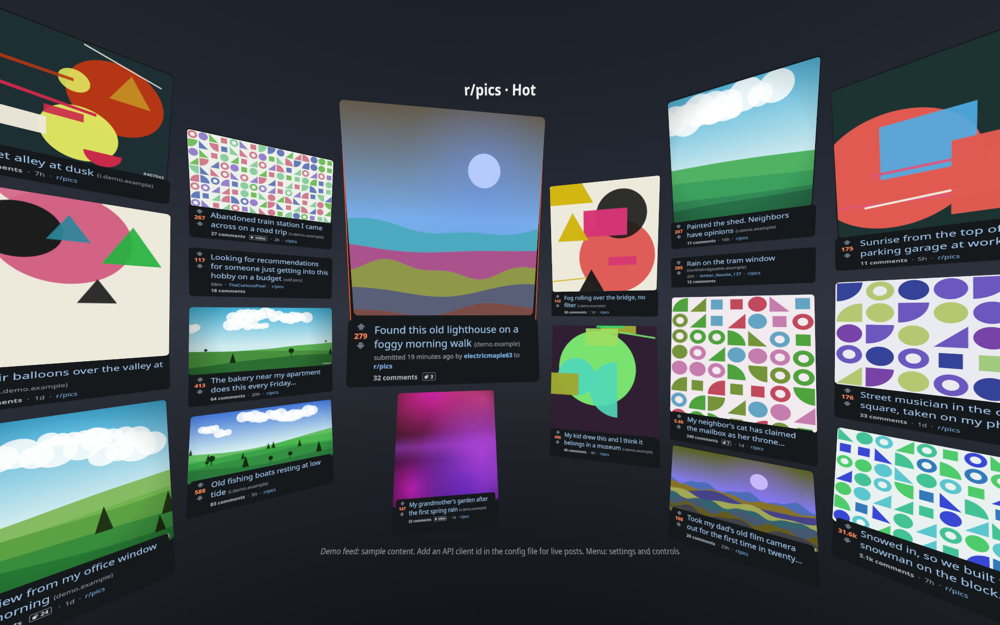
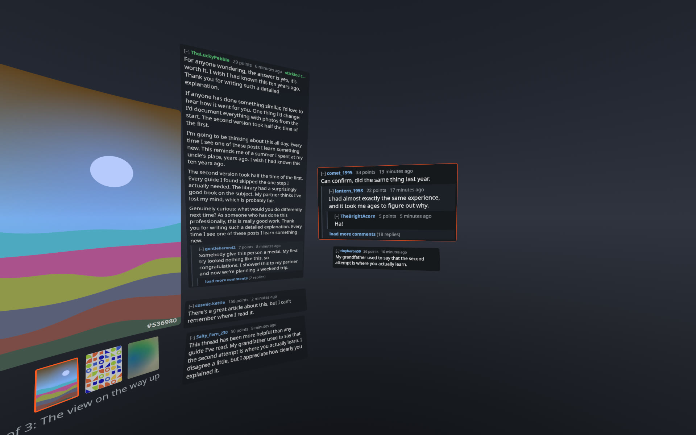
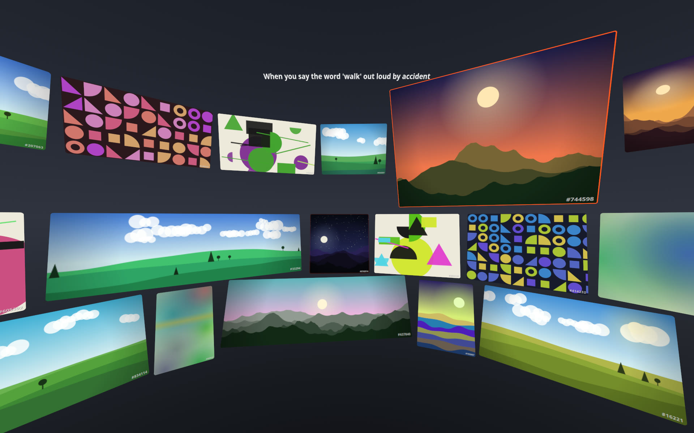
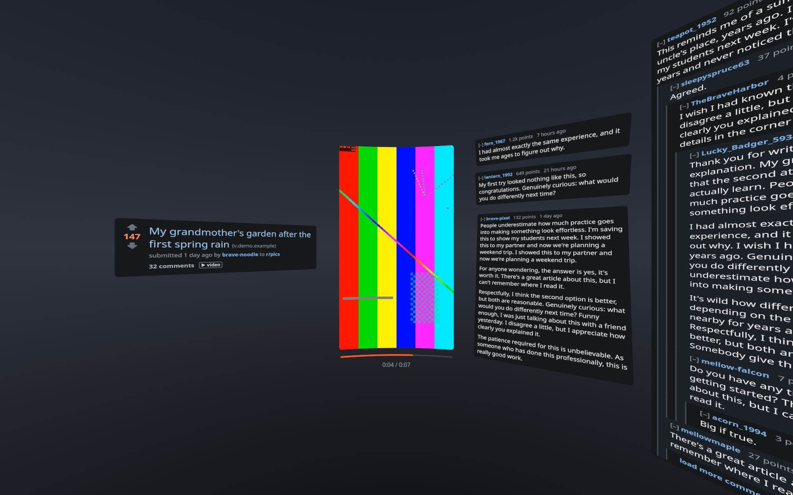
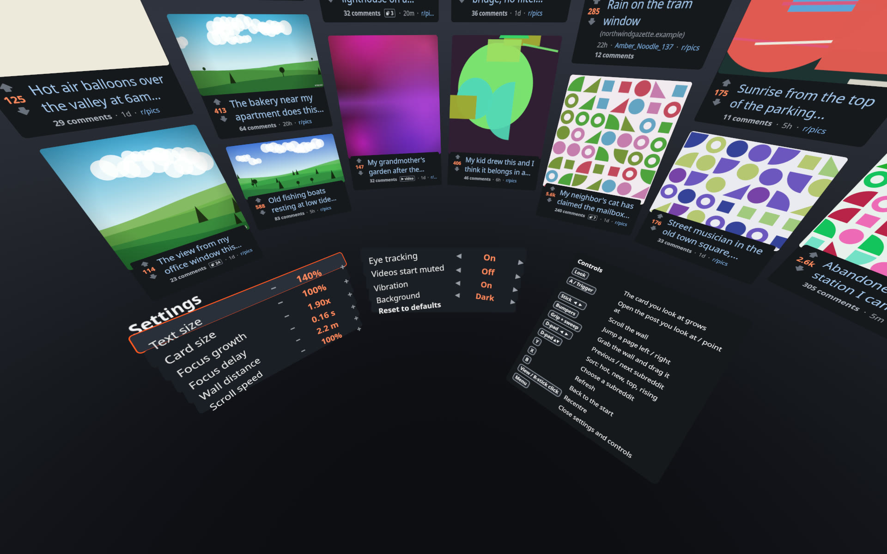

# VR Content Wall

A seated VR reader for link-and-discussion feeds. Posts surround you as a wall
of cards; the one you look at grows, and nothing ever overlaps. It is a personal,
non-commercial hobby project for the Steam Frame headset (OpenXR), at the
prototype stage.

The first content source is Reddit, read through its official Data API. This is
an independent project: it is not affiliated with, endorsed by or sponsored by
Reddit, and it uses none of Reddit's logos or artwork.

> Every picture on this page shows the app's built-in demo feed: generated
> sample posts, pictures and comments. No real posts or users are shown.

## What it does

**A wall of posts around you.** You sit at the centre of a curved wall of post
cards that fills your field of view. Each card shows the title, score, comment
count, community and a picture if the post has one. The stick scrolls the wall;
more posts load as you go.

**What you look at grows.** The headset's eye tracking picks the card your gaze
rests on. It grows and shows more (full title, author, age, the start of the
text) while its neighbours shrink and move aside. Cards never cover each other.

**Posts open big.** A post's picture or video comes up large in front of you,
with the post's text on one side and the threaded comments in columns on the
other. Pictures can be zoomed until they fill your view.

**Galleries as a mosaic.** A gallery can be spread out with every picture
visible at once. The one you look at grows; pressing a button opens it large.

**Video** plays on the big panel with play, pause, skip and volume.

**Settings** sit on a desk below the wall: text size, card size, how much the
focused card grows, distance, scroll speed, eye tracking on or off, and more.

## How it uses the Reddit Data API

- **Official API only.** All requests go to `oauth.reddit.com` with an OAuth
  app-only token for an "installed app" client. There is no scraping and no use
  of undocumented endpoints.
- **Read-only.** It reads listings, comments and the list of popular
  communities. There is no login, so it cannot vote, post, comment, message or
  read anyone's account.
- **Personal and non-commercial.** No ads, no payments, no subscriptions, no
  sale of the app or of any data.
- **Your own client id.** The app ships without credentials. Each person who
  runs it registers their own app and supplies their own client id, so each
  person's use counts against their own rate limit.
- **Rate limits respected.** It reads the rate-limit headers and waits when the
  allowance runs low, backs off on HTTP 429, and makes at most two API requests
  at a time.
- **Honest User-Agent.** Requests carry a descriptive User-Agent naming the app
  and version. It never imitates a browser.
- **No data collection.** No analytics, telemetry or tracking. Nothing is sent
  anywhere except the requests above and the downloads of the pictures and
  videos a post links to.
- **Nothing archived.** Posts and comments are held in memory while shown and
  are fetched fresh each session. Downloaded pictures sit in a size-capped
  temporary cache on the headset and are evicted automatically.
- **No AI or machine-learning use.** Content is displayed to the person using
  the headset and nothing else. It is not used for training, and not analysed,
  aggregated or redistributed.
- **Mature content filtered.** Posts marked over-18 are dropped from listings
  by default.
- **Content shown as written.** Titles, text, authors, scores and communities
  are displayed unmodified, attributed to their author and community.

## Status

Early prototype. It runs on a development PC in a test mode with the demo feed,
and a build for the Steam Frame exists but is still being brought up on the
headset. The source code is not published yet.

## Contact

Questions or concerns: please open an issue on this repository.
